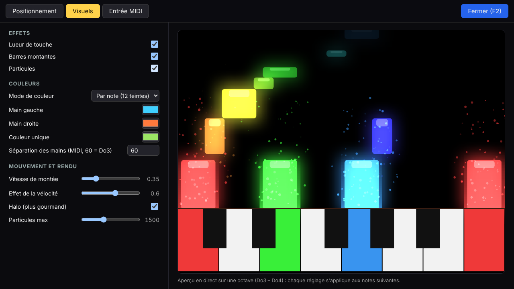

# PianoViz

Visualiseur MIDI live, projeté sur un mur au-dessus d'un piano numérique : chaque touche jouée fait naître un effet qui monte depuis la touche. Un mode tutoriel (notes qui descendent et attendent la bonne touche) viendra ensuite.




## Démarrer

Prérequis : Node.js 20 ou plus, et **Chrome, Chromium ou Edge** (Web MIDI n'existe pas dans Safari ni Firefox par défaut).

```bash
npm install
npm run dev        # ouvre http://localhost:5173
```

Branche le piano en USB avant ou après le lancement : il est détecté à chaud. Sans piano, le clavier virtuel et la démo (F4) suffisent pour tester.

| Commande | Rôle |
| --- | --- |
| `npm run dev` | Serveur de développement avec rechargement à chaud |
| `npm run build` | Vérification des types puis build dans `dist/` |
| `npm run preview` | Sert le build, comme en production |
| `npm test` | Tests unitaires (homographie, modèle de clavier, réglages, décodage MIDI) |

## Raccourcis

| Touche | Action |
| --- | --- |
| F2 | Ouvrir ou fermer les réglages (Échap pour fermer) |
| F3 | Afficher la mire |
| F4 | Démo automatique |
| F8 | Plein écran |
| A W S E D F T G Y H U J K… | Clavier virtuel (Z / X : octave, Maj : fort, Espace : pédale) |

## Réglages (F2)

Les réglages sont répartis en trois onglets.

- **Positionnement** (ouvert par défaut) : fais glisser les 4 poignées sur le mur. Bas gauche et bas droit à l'aplomb des bords du clavier, vus depuis le tabouret ; haut gauche et haut droit en haut de la zone d'effets. Touches `1`–`4` pour choisir un coin, flèches pour 1 px, Maj + flèches pour 10 px. La carte à côté regroupe les miroirs, la compensation de luminosité, le clavier (61, 76 ou 88 touches, ou « Apprendre ») et les profils. Le bouton ⇄ la passe de l'autre côté.
- **Visuels** : les options à gauche, et à droite un faux piano d'une octave qui joue en boucle pour voir chaque changement en direct.
- **Entrée MIDI** : choix du piano, démo, clavier virtuel et raccourcis.

Les réglages sont enregistrés dans le navigateur. Chaque lieu peut avoir son profil, et « Exporter » / « Importer » sauvegardent tout en JSON.

## Architecture

```
src/
  core/events.ts           Format d'événement de note commun + décodage MIDI
  core/keyboardModel.ts    Géométrie réaliste du clavier (61/76/88)
  midi/                    Sources : Web MIDI, clavier virtuel, démo, boucle d'aperçu
  visuals/                 Rendu PixiJS (WebGL) : barres montantes, lueur, particules, mire
  calibration/             Homographie 4 coins, transformation CSS matrix3d, poignées des coins
  config/settings.ts       Réglages, profils, sauvegarde et import
  ui/                      Écran de réglage en onglets et styles
```

Les modes visuels dessinent à plat dans un « repère piano » (x de 0 à 1 sur la largeur du clavier, effets qui montent depuis le bas). Le calibrage applique ensuite une seule homographie à toute l'image, via une transformation CSS `matrix3d` composée par le GPU. Changer de projecteur ou de lieu ne touche donc jamais aux visuels.

## Déploiement sur le mini-PC (à venir)

`npm run build`, puis servir `dist/` en local et lancer Chromium en mode kiosque, par exemple :

```bash
chromium --kiosk --autoplay-policy=no-user-gesture-required http://localhost:4173
```

L'autorisation MIDI est demandée une fois puis mémorisée par le navigateur.
